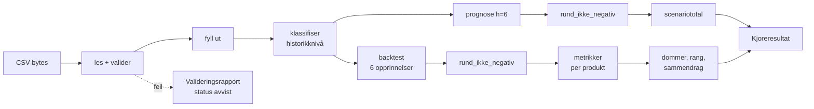
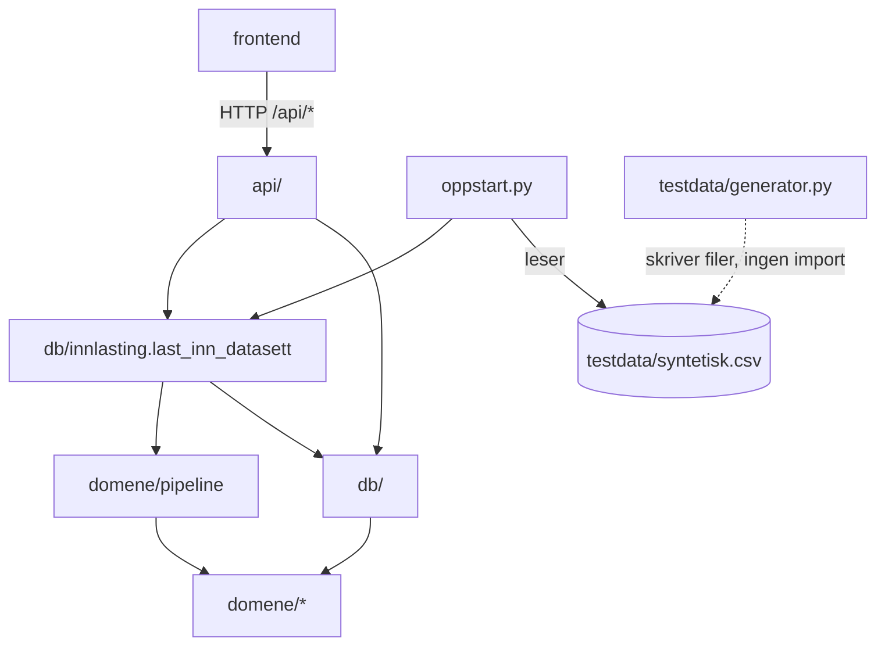
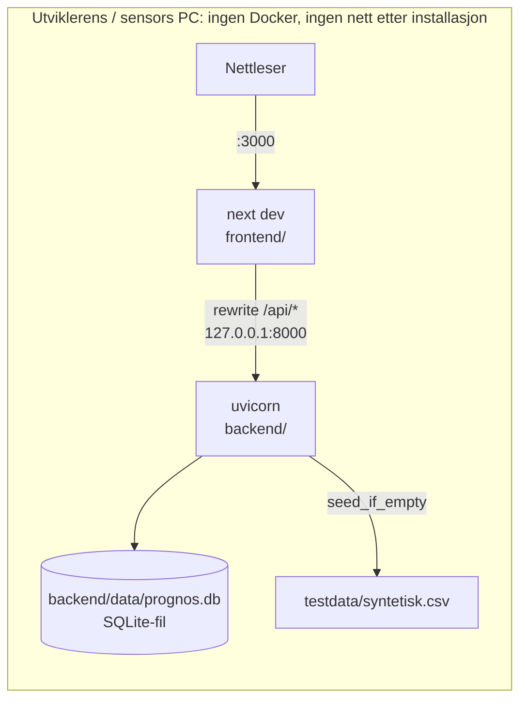
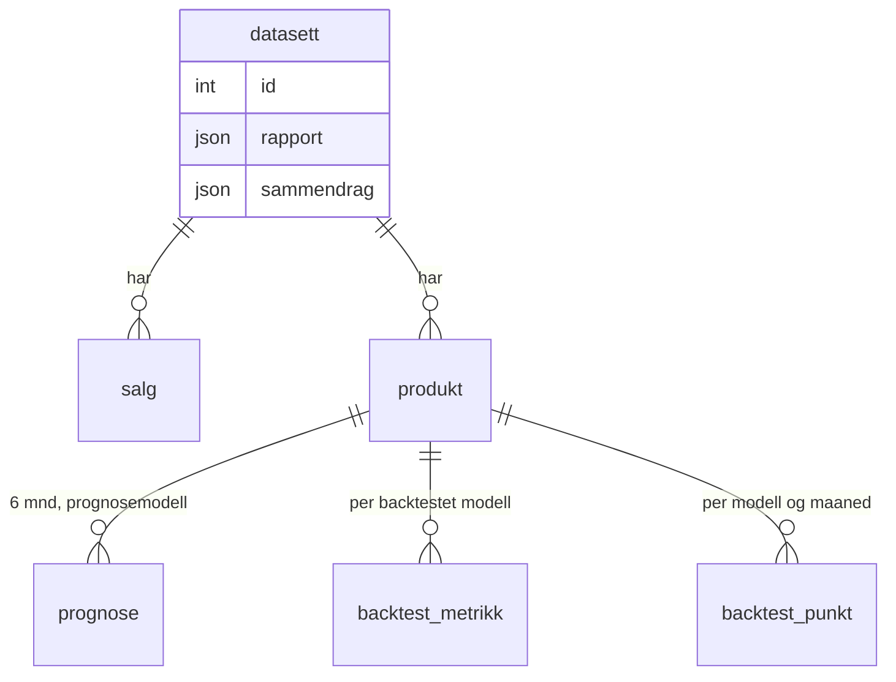

# Arkitekturspine: PROGNOS v1

Dette dokumentet erstatter [arkitektur-utkast.md](../../../../.docs/planning-artifacts/architecture/arkitektur-utkast.md). Ved konflikt gjelder denne rekkefølgen: beslutningsloggen i [research-plan.md](../../../../docs/research/research-plan.md), så [prd.md](../../prds/prd-G96-ellingsen-2026-11-14/prd.md), så dette dokumentet. Faste tekster i grensesnittet eies av [EXPERIENCE.md](../../ux-designs/ux-G96-ellingsen-2026-11-14/EXPERIENCE.md). De nye feilmalene i AD-15 og teksten for 409 er ført inn i EXPERIENCE.md 2026-11-17.

## Design Paradigm

**Functional core, imperative shell, organisert som en pipeline.**

- **Kjernen** (`backend/src/prognos/domene/`) består av rene funksjoner. De tar inn bytes eller pandas-data og returnerer frosne dataklasser. Kjernen gjør ingen I/O og importerer verken FastAPI, SQLAlchemy eller klokke.
- **Pipelinen** (`domene/pipeline.py`) kobler stegene sammen i fast rekkefølge og returnerer enten et samlet `Kjoreresultat` eller en avvist `Valideringsrapport`.
- **Skallet** (`api/`, `db/`, `oppstart.py`) leser forespørselen, kjører pipelinen, skriver resultatet i én transaksjon og serialiserer svaret.
- **Frontend** er et rent presentasjonslag. Det henter, formaterer og filtrerer, men regner aldri ut prognoser, metrikker eller rekkefølge.



## Invariants & Rules



Pilene viser hvem som kan importere hvem. `domene/` importerer ingenting fra `api/` eller `db/`. Generatoren importerer ikke backend.

### AD-1: Kjernen er ren og deterministisk, og skallet eier all I/O [ADOPTED]

- **Binds:** all backend
- **Prevents:** Beregninger som blandes med DB-kall og ikke kan testes mot håndregnet fasit (NFR-5), flere steder som kjører modeller, og resultater som avhenger av maskin eller rekkefølge.
- **Rule:**
  - Bare `domene/` kaller statsforecast og regner ut avrunding, WAPE, dekning, dommer, rang og scenariototaler.
  - `domene/` importerer aldri `fastapi`, `sqlalchemy`, `prognos.api` eller `prognos.db`. En importtest håndhever dette.
  - Samme CSV-innhold gir identisk `Kjoreresultat` (F9, F13). Produktene behandles sortert på `produkt_id`, og statsforecast kjøres med `n_jobs=1` og uten `fallback_model`.
  - En ikke-endelig verdi (NaN eller inf) fra en modell er en kjøringsfeil, og ingenting lagres (AD-2).

### AD-2: Alt eller ingenting, én innlastingsvei, serverfrist [ADOPTED]

- **Binds:** FR-3, FR-7, FR-25, NFR-7
- **Prevents:** Halvt lagrede datasett, at opplasting og seed går ulike veier, og at «Ingenting er lagret» er usant når klienten har gitt opp.
- **Rule:**
  - `db/innlasting.py::last_inn_datasett(innhold: bytes, filnavn: str)` er den **eneste** veien inn. Både `POST /api/datasets` og `seed_if_empty` (FR-25) kaller den.
  - Funksjonen kjører hele pipelinen i minnet. Deretter skriver den `datasett` og alle barnetabeller i **én** `AsyncSession`-transaksjon.
  - Avviste filer og feilede kjøringer gir aldri rader.
  - Hvis pipelinen bruker mer enn `SERVERFRIST_S = 110` sekunder, forkastes resultatet uten skriving, og svaret er `feilet` med koden `tidsavbrudd`. Klientens grense er 120 s.
  - Hvis seedingen feiler, stopper backend med feilmelding. Det syntetiske datasettet skal alltid kunne lastes inn.

### AD-3: Metrikker regnes én gang i kjernen og lagres. Lesere regner aldri på nytt [ADOPTED]

- **Binds:** FR-12–FR-17, FR-19, FR-21, FR-22, NFR-5, F11 (løser H6)
- **Prevents:** To implementasjoner av reglene for WAPE, total, dekning, «n av m», scenariototal og sortering (Python ved skriving og SQL eller TS ved lesing), som kan gi ulike tall.
- **Rule:** Kjernen regner ut og skiller lagres:
  - `salg` per produkt og måned: `antall` og `utfylt`.
  - `prognose` per produkt og måned i horisonten, for `prognosemodell`: `p10`, `p50` og `p90`.
  - `backtest_punkt` per produkt, modell og `maaned`: `opprinnelse`, `faktisk`, `p10`, `p50`, `p90`, `avvik` = |faktisk − p50| og `i_spenn` = p10 ≤ faktisk ≤ p90.
  - `backtest_metrikk` per produkt og modell, **bare** for modeller som er backtestet: `antall_punkt` (alltid 6), `sum_faktisk`, `sum_avvik`, `wape` (= sum_avvik / sum_faktisk, `NULL` når sum_faktisk = 0), `antall_treff` og `dekning` (= antall_treff / antall_punkt).
  - Felt på `produkt`: `historikklengde`, `historikknivaa`, `prognosemodell`, `backtest_nivaa`, `scenario_p10`, `scenario_p50` og `scenario_p90` (summer av horisonten, `NULL` uten prognose), samt `dommer`, `flagg_*`, `liste_wape` og `rang` (AD-7).
  - `datasett.sammendrag` (AD-4).

  API-et serialiserer disse verdiene uendret. Frontend formaterer bare. Ingen SQL-`SUM`/`AVG` og ingen TS-kode regner ut WAPE, dekning, summer eller rekkefølge.

### AD-4: Mengden for totalene er én definisjon [ADOPTED]

- **Binds:** FR-14, FR-15, FR-22, F7, F8
- **Prevents:** At total WAPE, total dekning og «n av m» regnes over ulike produkter.
- **Rule:** Sammenligningsmengden *S* er produktene med `backtest_nivaa = begge` **og** sum_faktisk > 0. Over *S* gjelder:
  - `total_wape[modell]` = Σ sum_avvik / Σ sum_faktisk
  - `total_dekning[modell]` = Σ antall_treff / Σ antall_punkt
  - `m` = |S|, og `n` = antall i *S* med `dommer = ets_slaar`

  Når |S| = 0, er `m = 0` og `n = 0`, og alle `total_*` er `null`. Frontend bruker da malen for m = 0. F7 og F8 testes mot disse lagrede feltene.

### AD-5: Nullgrense og så heltallsavrunding, i én funksjon, før all videre bruk [ADOPTED]

- **Binds:** FR-9, FR-11, FR-12, FR-14, FR-15, FR-24, NFR-5, F2, F6, F8
- **Prevents:** At viste heltall gir en annen WAPE, dekning eller scenariototal enn den som vises når Kari regner etter, og to avrundingsvarianter.
- **Rule:**
  - `domene/avrunding.py::rund_ikke_negativ(x: np.ndarray) -> np.ndarray[int64]` = `np.floor(np.maximum(x, 0) + 0.5)`. Den kalles på alle P10, P50 og P90 fra statsforecast, både i prognosen og i backtesten, rett etter at ikke-endelige verdier er sjekket (AD-1).
  - Etter dette steget finnes bare heltall. Alle videre beregninger bruker bare disse.
  - P10 ≤ P50 ≤ P90 sjekkes etter avrundingen (F2), og brudd er en kjøringsfeil.
  - Med nøyaktig 12 treningspunkter gir SeasonalNaive null bredde (P10 = P50 = P90). Det er akseptert, fordi disse punktene aldri inngår i *S*.
  - Beslutningslogg: *Avrunding til heltall*.

### AD-6: Modell, backtest og statsforecast-kall etter historikklengde. Én modul eier tabellen [ADOPTED]

- **Binds:** FR-5, FR-8, FR-10, FR-13, FR-16, FR-17
- **Prevents:** At grensene 12, 18, 24 og 30 implementeres flere steder, at månedene forskyves mot statsforecast, og at frontend gjenskaper grensene.
- **Rule:** `domene/nivaa.py` er eneste kilde for grensene. Historikklengden telles med begge endepunktene, fra produktets første måned til og med datasettets `siste_maaned`, etter utfylling.

  | Historikklengde | `historikknivaa` | `prognosemodell` | `backtest_nivaa` |
  |---|---|---|---|
  | < 12 | `ingen` | `null` | `ingen` |
  | 12–17 | `sesongnaiv` | `sesongnaiv` | `ingen` |
  | 18–23 | `sesongnaiv` | `sesongnaiv` | `sesongnaiv` |
  | 24–29 | `ets` | `ets` | `sesongnaiv` |
  | ≥ 30 | `ets` | `ets` | `begge` |

  Kall mot statsforecast (`domene/modeller.py`, `backtest.py`):
  - `ds` er `pd.Timestamp` for den første i måneden, og `freq="MS"`.
  - `cutoff` fra `cross_validation` mappes til `opprinnelse`, og `ds` mappes til `maaned`. Begge er `ÅÅÅÅ-MM`.
  - Modellene er `AutoETS(season_length=12)` og `SeasonalNaive(season_length=12)`, med `level=[80]`. P10 er `-lo-80` og P90 er `-hi-80`.
  - **Prognose:** ett `forecast(h=6)`-kall per modell, over alle produktene med den `prognosemodell`. Bare prognosen fra `prognosemodell` lagres (FR-10).
  - **Backtest:** ett `cross_validation(h=1, n_windows=6, step_size=1)`-kall per modell, over alle produktene som skal backtestes med den modellen. Serier med ulik lengde går i samme kall.

  Frontend velger tilstand i backtest-tabellen bare ut fra `backtest_nivaa`.

### AD-7: Dommer, flagg og rang er lagrede verdier [ADOPTED]

- **Binds:** FR-17, FR-19, FR-21, FR-26
- **Prevents:** At frontend og backend avleder dommerlinje, flagg eller rekkefølge hver for seg, og at flyttall sammenlignes.
- **Rule:** Kjernen setter disse verdiene per produkt:
  - `dommer`:
    - `null` når `backtest_nivaa ≠ begge`
    - ellers `kan_ikke_sammenlignes` når sum_faktisk = 0
    - ellers en sammenligning av heltallene `sum_avvik[ets]` og `sum_avvik[sesongnaiv]`, som har samme nevner: mindre gir `ets_slaar`, større gir `ets_taper`, og like gir `lik`
  - `flagg_kort_historikk` = nivå ∈ {`ingen`, `sesongnaiv`}, og `flagg_ets_taper` = (`dommer = ets_taper`). Et produkt er *flagget* når minst ett flagg er sant.
  - `liste_wape` = ETS-WAPE når `backtest_nivaa = begge`, ellers baseline-WAPE, ellers `null`.
  - `rang` = 1…N etter FR-19:
    1. Flaggede produkter etter `liste_wape` synkende, med `null` sist.
    2. Uflaggede produkter med `liste_wape` `null`.
    3. Resten etter `liste_wape` synkende.

    Like verdier sorteres etter `produkt_id` stigende med Pythons `str`-sammenligning.

  `GET …/products` returnerer listen sortert på `rang`. Frontend sorterer aldri på nytt. Søket (FR-26) filtrerer i klienten med `produkt_id.toLowerCase().includes(sok.toLowerCase())`.

### AD-8: Valideringsrapporten er ett objekt, bygget av kjernen og lagret i sin helhet [ADOPTED]

- **Binds:** FR-1–FR-5, FR-7, FR-18 (løser H6 punkt 4)
- **Prevents:** At rapporten etter opplasting og ved gjenåpning får ulik form, at feiltekster formuleres to steder, og at skallet og kjernen bygger hver sin del av rapporten.
- **Rule:** Én Pydantic-modell, `Valideringsrapport`, med disse feltene:
  - `status` ∈ {`godkjent`, `avvist`, `feilet`}
  - `feil[]` med {`kode`, `melding`, `rader[]`}
  - `advarsler[]` med {`produkt_id`, `maaneder[]`, `melding`}
  - `antall_produkter`, `per_nivaa` med {`ingen`, `sesongnaiv`, `ets`} og `antall_kort_historikk`

  Ansvaret er delt slik:
  - Kjernen bygger `godkjent` og `avvist`.
  - Skallet bygger bare `feilet`, med én feil som har kode `kjoring`, `tidsavbrudd`, `opptatt`, `ugyldig_forespoersel` eller `uventet`.
  - Backend skriver `melding` ferdig på norsk, og frontend viser den uendret.

  En godkjent rapport lagres som JSON i `datasett.rapport`. `GET /api/datasets/{id}` returnerer den som samme JSON-verdi. Advarsler sorteres på `produkt_id`, og månedene i dem stigende.

### AD-9: API-kontrakten: seks endepunkter, eid av Pydantic [ADOPTED]

- **Binds:** alle FR med data, NFR-2, NFR-4, NFR-8, F11
- **Prevents:** At frontend og backend antar ulik form på svarene, engelske eller uformelige feilsvar fra rammeverket, og endepunkter som vokser frem ad hoc.
- **Rule:** Bare disse endepunktene finnes. Ingen av dem krever autentisering.

  | Endepunkt | Svar |
  |---|---|
  | `POST /api/datasets` (multipart, felt `fil`) | `201 {datasett_id, rapport}` · `422 {rapport}` når status er `avvist` · `500 {rapport}` når status er `feilet` · `409 {rapport}` med koden `opptatt` |
  | `GET /api/datasets` | `[{id, filnavn, opplastet}]`, sortert på `opplastet` og deretter `id`, nyeste først |
  | `GET /api/datasets/{id}` | `{id, filnavn, opplastet, skilletegn, siste_maaned, rapport, sammendrag}` |
  | `GET /api/datasets/{id}/products` | `[{produkt_id, historikknivaa, backtest_nivaa, liste_wape, flagg_kort_historikk, flagg_ets_taper, rang}]`, sortert på `rang` |
  | `GET /api/datasets/{id}/products/{produkt_id:path}` | `{produkt_id, historikklengde, historikknivaa, prognosemodell, backtest_nivaa, dommer, flagg_*, historikk[{maaned, antall, utfylt}], prognose[{maaned, p10, p50, p90}], scenariototal{p10, p50, p90} \| null, backtest{sesongnaiv, ets}}`. Hver modell har `null` eller `{metrikk{antall_punkt, sum_faktisk, sum_avvik, wape, antall_treff, dekning}, punkter[{maaned, opprinnelse, faktisk, p10, p50, p90, avvik, i_spenn}]}` |
  | `GET /api/health` | `200 {status: "ok"}` |

  Regler for svarene:
  - Alle lister med måneder er sortert stigende på `maaned`. I detaljtabellen er kolonnen *Måned* lik `maaned`, altså måneden det prognoseres for. Baseline og ETS kobles på `maaned`, og sumraden bruker `metrikk`.
  - Frontend koder `produkt_id` med `encodeURIComponent`.
  - Globale unntakshåndterere sørger for at **alle** svar fra `POST /api/datasets`, også `RequestValidationError` og uventede unntak, har formen `{rapport}` med norsk melding. Feil på GET gir `{detail}` med norsk tekst.
  - Pydantic-skjemaene i `api/skjema.py` er kontrakten. zod-skjemaene i `frontend/lib/api/skjema.ts` er en håndskrevet kopi, og en kontrakttest parser ekte svar fra backend med zod.

### AD-10: CPU-arbeid i trådpool, én opplasting om gangen [ADOPTED]

- **Binds:** FR-7, NFR-2, NFR-7
- **Prevents:** At statsforecast blokkerer event-loopen, slik at `/api/health` og lesing henger, og at to samtidige kjøringer konkurrerer.
- **Rule:**
  - Ruten er `async`. Pipelinen kjøres med `starlette.concurrency.run_in_threadpool`, og skrivingen gjøres etterpå i async.
  - En prosessvid `asyncio.Lock` slipper bare én innlasting av gangen. Låsen holdes til pipelinetråden er ferdig, også etter serverfristen (AD-2).
  - En låst lås gir straks `409`. Lesing tar ikke låsen.

### AD-11: Én origin, lang proxytid, ingen eksterne kall fra appen

- **Binds:** NFR-1, FR-7, NFR-7
- **Prevents:** CORS-oppsett, miljøvariabler, at opplastinger over 30 s brytes av Next-proxyen (standard 30 000 ms i next@16.4.6), og at appen henter noe fra nettet.
- **Rule:**
  - Frontend kaller bare relative `/api/*`. Backend har ingen CORS, og ingen kode leser miljøvariabler.
  - `next.config.ts` har en rewrite fra `/api/:path*` til den hardkodede adressen `http://127.0.0.1:8000/api/:path*`, og `experimental: { proxyTimeout: 130000, agentUpgrade: false }`. Klienten gir opp etter 120 s.
  - Next-telemetrien slås av i `predev` og `prebuild`.
  - Bare systemfonter brukes, så importen av `next/font/google` fra create-next-app-malen fjernes. Ingen CDN.
  - `next dev` sjekker selv versjonen mot registry.npmjs.org. Det kallet feiler stille uten nett og er ikke en del av appen. NFR-1 testes med nettverket koblet fra.
  - Filer over 10 MB (proxygrensen) støttes ikke.

### AD-12: All datahenting i frontend går gjennom én klient og TanStack Query

- **Binds:** FR-18–FR-22, FR-26
- **Prevents:** At noen komponenter henter i Server Components og andre i klienten, og at tilstandene *Kjøring feilet* og *Ingen kontakt* klassifiseres forskjellig.
- **Rule:**
  - Dashbordet er én klientkomponent på `app/page.tsx`. Det finnes ingen route handlers og ingen Server Actions.
  - Alle kall går gjennom `frontend/lib/api/klient.ts`, som parser svarene med zod og klassifiserer dem slik:
    1. Et svar med gyldig `{rapport}` vises som rapporten.
    2. Et nettverksfeil, et svar som ikke er JSON, et svar som ikke passer skjemaet, eller status 502/503/504 gir *Ingen kontakt med backend*.
    3. Avbrudd etter 120 s gir *Kjøring feilet* med teksten for tidsavbrudd.
  - Spørringsnøklene er faste: `['datasett']`, `['datasett', id]`, `['produkter', id]` og `['produkt', id, produkt_id]`, der `id` er et tall og `produkt_id` en streng.
  - Lagrede data endres ikke, så `staleTime: Infinity`. En godkjent opplasting invaliderer bare `['datasett']`.

### AD-13: Skjema med `create_all` og versjonsvakt før opprettelse [ADOPTED]

- **Binds:** NFR-2, NFR-9, FR-25
- **Prevents:** Stille feil mot en gammel databasefil, og et migreringsverktøy ingen trenger i v1.
- **Rule:**
  - Vakten kjører **før** `create_all`.
  - En fil uten tabeller initialiseres: `create_all` kjøres, og `SKJEMAVERSJON` settes inn i samme transaksjon.
  - En fil som har tabeller, men der `skjemaversjon` mangler eller har en annen verdi, stopper backend med meldingen «Databasefila har gammelt skjema. Slett backend/data/prognos.db og start på nytt.»
  - Hver skjemaendring øker `SKJEMAVERSJON`. Det brukes ingen Alembic i v1.

### AD-14: Testbar app uten miljøvariabler

- **Binds:** NFR-1, NFR-6, F10, F11
- **Prevents:** At pytest og Playwright skriver i utviklerens database, eller at noen innfører miljøvariabler for testoppsett.
- **Rule:**
  - `main.py::lag_app(db_sti: Path) -> FastAPI` er eneste fabrikk. `app = lag_app(STANDARD_DB_STI)` brukes av `uvicorn prognos.main:app`.
  - `python -m prognos --db STI --port N` starter med en annen fil.
  - Skalltestene lager appen med en midlertidig fil, åpner `app.router.lifespan_context(app)`, og kaller så `httpx.AsyncClient(transport=httpx.ASGITransport(app))`.
  - Playwright sin `webServer` starter backend med `--db` mot en midlertidig fil, og starter frontend med `npm run dev`.
  - F11 testes ved å lage appen på nytt mot samme fil.

### AD-15: CSV-leseren og rekkefølgen på feil

- **Binds:** FR-1–FR-4, F4, F13, NFR-4
- **Prevents:** Feil radnummer, at `"001"` og `"1"` blir like, at `12,5` i en kommafil leses feil uten varsel, og at feillisten får ulik rekkefølge fra gang til gang.
- **Rule:**
  - `domene/csv.py` bruker `csv.reader` på tekst dekodet som `utf-8-sig`, aldri `pandas.read_csv`. Radnummeret er `reader.line_num`.
  - Linjer der alle cellene er tomme, hoppes over, men telles med.
  - Alle verdier leses som `str` og `strip()`-es. Overskriftene skiller mellom store og små bokstaver.
  - Skilletegnet velges slik:
    - Det tegnet (`,` eller `;`) som gir flest påkrevde kolonner i overskriften, velges.
    - Hvis ingen av dem gir noen påkrevd kolonne, eller begge gir like mange, gir det koden `skilletegn`.
    - Hvis det valgte tegnet gir færre enn tre påkrevde kolonner, gir det `mangler_kolonne` for hver kolonne som mangler.
  - Verdiene er gyldige når `antall` matcher `^[0-9]+$` og `maaned` matcher `^\d{4}-(0[1-9]|1[0-2])$`.
  - En rad med flere felt enn overskriften gir `antall_felt`, med den nye malen «Rad {r}: har {k} felt, men overskriften har {h}». Det samme gjelder for færre felt når en påkrevd celle mangler, med koden `tom_celle`.
  - Et duplikat gir én feil per ekstra rad: «Duplikat: {produkt_id}, {maaned} (rad {første} og {r})».
  - Fila avvises med koden `tegnkoding` når den ikke kan dekodes som UTF-8. Den nye malen er «Fila er ikke lagret som UTF-8. Lagre den som «CSV UTF-8» i Excel og prøv igjen.»
  - Rekkefølgen på feilene er:
    1. Feil i fila som helhet: `tegnkoding`, `skilletegn`, `mangler_kolonne`, `ingen_datarader`.
    2. Radfeil etter radnummer, og innenfor en rad etter kolonnerekkefølgen. Kodene er `tom_celle`, `antall_felt`, `maaned_format`, `antall_ugyldig` og `duplikat`.

## Consistency Conventions

| Område | Konvensjon |
|---|---|
| Navn | Norsk snake_case i CSV, DB, JSON og TS-typer, uten alias og uten camelCase. Æ, ø og å skrives `ae`, `oe` og `aa` i identifikatorer (`maaned`, `historikknivaa`, `ets_slaar`). Modell-id-ene er `ets` og `sesongnaiv`, og baseline heter alltid `sesongnaiv` i kode. Moduler og filer har norske navn. |
| Måneder | Strenger på formen `ÅÅÅÅ-MM` i API og DB. `opprinnelse` er siste treningsmåned, og `maaned` = opprinnelse + 1 måned. Visningsformatet («nov. 2026») lages bare i `frontend/lib/format.ts`. |
| Tidspunkt | `opplastet` lagres som naiv UTC i SQLite. Pydantic serialiserer alltid til ISO 8601 med `Z`. Frontend formaterer i `Europe/Oslo` som «13.11.2026 kl. 09.42». |
| Tall | Antall, P-verdier, summer og avvik er heltall i JSON (AD-5). WAPE og dekning er urundede brøker 0–1. `null` betyr udefinert eller fraværende, aldri 0. Prosent vises med `Intl.NumberFormat('nb-NO', {style: 'percent', minimumFractionDigits: 1, maximumFractionDigits: 1})` for WAPE og 0 desimaler for dekning, bare i `lib/format.ts`. |
| Id-er | `datasett.id` er et autoinkrementert heltall. Et produkt identifiseres med (`datasett_id`, `produkt_id`), der `produkt_id` er den `strip()`-ede strengen fra CSV-fila. |
| Feil | Domenefeil er egne unntak i `domene/feil.py`. Skallet oversetter dem etter AD-8 og AD-9. Uventede unntak logges med stakk til stdout. |
| Logging | Standard `logging` til stdout. Ingen eksterne loggtjenester. Kjøretid per pipelinesteg logges på INFO (NFR-7). |
| Konfigurasjon | Ingen. Stier, port og frister er konstanter i `prognos/konstanter.py` og i `next.config.ts`. `.env.example` sier bare at v1 ikke trenger variabler (NFR-9). |
| Tekster | Meldinger i rapporten eies av backend (AD-8, AD-15), også teksten for 409. Alle andre faste tekster, også `aria-label` på grafen for nivå *ingen*, eies av frontend i `frontend/lib/tekster.ts`, ordrett fra EXPERIENCE.md. Ingen engelske brukertekster (NFR-4). |
| Tester | Kjernen testes med pytest uten DB. NFR-5-fasiten i `backend/tests/fasit/` er håndskrevne backtest-punkter og prognoser, som sendes direkte til `metrikker.py`, `rangering.py` og `scenario.py`. AutoETS håndregnes ikke. Skallet testes etter AD-14. Playwright kjører mot ekte backend med seed. Alle testkommandoer står i README. |
| Testdata | `testdata/generator.py` (seed 42) skriver tre filer: `syntetisk.csv` (komma, UTF-8 uten BOM, `\n`, sortert på `produkt_id` og `maaned`), `fasit.json` (`sort_keys=True`, `indent=2`, `ensure_ascii=False`, avsluttende `\n`) og `uten_stoy.csv`. `uten_stoy.csv` er et støyfritt produkt med nivå ≥ 20, brukt bare i 5 %-testen i FR-24. Filene sjekkes inn. `.gitattributes` har `testdata/*.csv -text` og `testdata/*.json -text`, i tillegg til den globale regelen `eol=lf`. F9-testen genererer på nytt og sammenligner bytes. Fila på 200 × 36 for NFR-7 genereres i testen og sjekkes ikke inn. |

## Stack

Versjonene er sjekket mot PyPI og npm 2026-11-17.

| Navn | Versjon |
|---|---|
| Python | 3.12 |
| uv | 0.13.x |
| FastAPI | 0.163.x |
| python-multipart | gjeldende ved `uv add` (påkrevd for `UploadFile`) |
| Uvicorn | 0.54.x |
| Pydantic | 2.14.x |
| SQLAlchemy | 2.1.x med extra `[asyncio]` |
| aiosqlite | 0.22.x |
| statsforecast | 2.1.1 |
| pandas | 2.3.3 (statsforecast 2.1.1 krever `pandas<3`) |
| numpy | 2.5.x |
| pytest / pytest-asyncio | 9.2.x / 1.5.x |
| httpx | 0.28.x |
| Node.js | ≥ 22.12 |
| Next.js (App Router) | 16.4.x |
| React / react-dom / react-is | 19.3.x |
| TypeScript | 5.9.x |
| Tailwind CSS | 4.3.x |
| shadcn/ui (CLI) | gjeldende ved init. `chart`-komponenten brukes ikke, og Recharts brukes direkte. |
| TanStack Query | 5.108.x |
| zod | 4.6.x |
| Recharts | 3.11.x |
| Vitest / Playwright | 5.1.x / 1.65.x |

## Structural Seed





`datasett` har også `filnavn`, `opplastet`, `skilletegn` og `siste_maaned`. `sammendrag` er {`total_wape`: {sesongnaiv, ets}, `total_dekning`: {sesongnaiv, ets}, `n`, `m`}. Feltene i de andre tabellene står i AD-3. Primærnøklene er sammensatte, med (`datasett_id`, `produkt_id`, …). Tabellen `skjemaversjon` hører til AD-13.

```text
backend/
  pyproject.toml          # uv-prosjekt, låste versjoner
  src/prognos/
    domene/               # REN KJERNE: csv.py, validering.py, utfylling.py, nivaa.py,
                          #   modeller.py, backtest.py, avrunding.py, metrikker.py,
                          #   scenario.py, rangering.py, pipeline.py, typer.py, feil.py
    db/                   # SQLAlchemy-modeller, økt, innlasting.py, lesefunksjoner
    api/                  # ruter, skjema.py (kontrakten), unntakshåndterere
    oppstart.py           # lifespan: versjonsvakt, create_all, seed_if_empty
    konstanter.py
    main.py, __main__.py  # lag_app(), CLI med --db og --port
  data/                   # prognos.db (git-ignorert)
  tests/                  # domene/, api/, fasit/ (NFR-5)
frontend/
  app/page.tsx            # dashbordet (klientkomponent)
  components/             # topplinje, rapport, produktliste, graf, tabeller, wape-oversikt
  lib/api/                # klient.ts, skjema.ts (zod), sporringer.ts
  lib/format.ts, lib/tekster.ts
  next.config.ts          # rewrite + experimental.proxyTimeout + agentUpgrade
  e2e/                    # Playwright
testdata/
  generator.py            # seed 42 (FR-23, FR-24)
  syntetisk.csv, fasit.json, uten_stoy.csv
spikes/                   # eksisterende spike, ikke en del av appen
```

**Kjøring:** Backend startes med `uv run uvicorn prognos.main:app --port 8000` fra `backend/`, og frontend med `npm run dev` fra `frontend/`. README lister forutsetningene (Python 3.12, uv, Node ≥ 22.12), og kommandoene for installasjon, start, `uv run pytest`, `npm test` og `npx playwright test`. Den sier også at det syntetiske datasettet lastes inn automatisk, og hvilken maskin NFR-7 er målt på.

## Capability → Architecture Map

| Krav | Lever i | Styres av |
|---|---|---|
| FR-1–FR-4 (CSV, skilletegn, validering, utfylling) | `domene/csv.py`, `validering.py`, `utfylling.py` | AD-1, AD-8, AD-15 |
| FR-5, FR-10, FR-16 (nivå, modellvalg, backtest-grenser) | `domene/nivaa.py`, `modeller.py` | AD-6 |
| FR-6, F11, NFR-3 (lagring og gjenåpning) | `db/` | AD-2, AD-3, AD-13, AD-14 |
| FR-7 (automatisk kjøring i én forespørsel) | `api/`, `db/innlasting.py` | AD-2, AD-10, AD-11 |
| FR-8, FR-9, FR-11, FR-12 (prognose, intervall, scenarioer) | `domene/modeller.py`, `avrunding.py`, `scenario.py` | AD-3, AD-5, AD-6 |
| FR-13–FR-15 (backtest, WAPE, dekning) | `domene/backtest.py`, `metrikker.py` | AD-3, AD-4, AD-5 |
| FR-17, FR-19 (ETS taper, sortering) | `domene/rangering.py` | AD-7 |
| FR-18 (topplinje og rapport ved gjenåpning) | `GET /api/datasets/{id}`, `components/` | AD-8, AD-9 |
| FR-20, FR-21 (graf, tabeller, detaljer per opprinnelse) | `GET …/products/{produkt_id}`, `components/` | AD-3, AD-6, AD-9, AD-12 |
| FR-22 (WAPE-oversikt) | `datasett.sammendrag` | AD-3, AD-4 |
| FR-26 (søk) | frontend, i klienten | AD-7, AD-12 |
| FR-23, FR-24 (generator) | `testdata/generator.py` | konvensjonen *Testdata*, seed 42 |
| FR-25 (seed ved tom DB) | `oppstart.py` → `last_inn_datasett` | AD-2, AD-13 |
| NFR-1, NFR-2 (lokal kjøring, helse) | `next.config.ts`, `oppstart.py`, README | AD-11, AD-13, AD-14 |
| NFR-5 (etterprøvbarhet) | `backtest_punkt`, `tests/fasit/` | AD-3, AD-5, konvensjonen *Tester* |
| NFR-6 (testdekning) | `backend/tests/`, `frontend/e2e/` | AD-14 |
| NFR-7 (60 s) | `db/innlasting.py` + pipeline | AD-2, AD-10, AD-11 |

**Avstemt mot beslutningsloggen.** Disse fem punktene var utdatert i utkastet og er rettet her:

- *Total WAPE*: AD-4
- *Sortering av produktlisten*: AD-7
- *Backtest for 12–17 mnd*: AD-6
- *WAPE når faktisk salg er 0*: AD-3, AD-4 og AD-7
- *Intervalldekning og sortering*: AD-4 og AD-7

Historikknivået heter `sesongnaiv`, ikke `baseline` (AD-6).

## Deferred

- **Oppvarming ved oppstart (NFR-7).** statsforecast 2.1.1 bruker ikke numba. NFR-7 tas tid på etter én oppvarmingskjøring. Om backend skal varme opp ved oppstart, avgjøres bare hvis den kalde kjøringen nærmer seg serverfristen på 110 s.
- **ETS-intervaller som er for smale (F8).** Ingen arkitekturendring. Kjør spiken på nytt mot `testdata/syntetisk.csv` (issues.md). Intervallnivået ligger fast (SM-C2).
- **CI.** v1 har ingen CI-tjeneste. Testene kjøres lokalt med kommandoene i README. Arbeidsflyten i GitHub Actions kan legges til senere uten å endre noen AD.
- **Hvordan økten husker åpne tabeller** (EXPERIENCE.md). Dette er frontend-lokalt, for eksempel `sessionStorage` med try/catch, og påvirker ingen andre enheter.
- **Komponentoppdeling og stil i frontend.** DESIGN.md eier utseendet, og koden eier strukturen under `components/`.
- **Sletting og omdøping av datasett, eksport, flere brukere og deploy.** Utenfor v1 (PRD §7.2).
- **Trinn 2.** `inventory`, anbefaling, LLM-forklaring, feature flags og mock-fallback er utenfor v1. v1 kaller ingen ekstern tjeneste, så det finnes ingenting å mocke, og koden har ingen forberedelse for trinn 2.
- **ERP-formater utover reglene** (PRD §10 spm. 2). Kan gi bedre feilmeldinger innenfor AD-15, men ikke nye formater.
